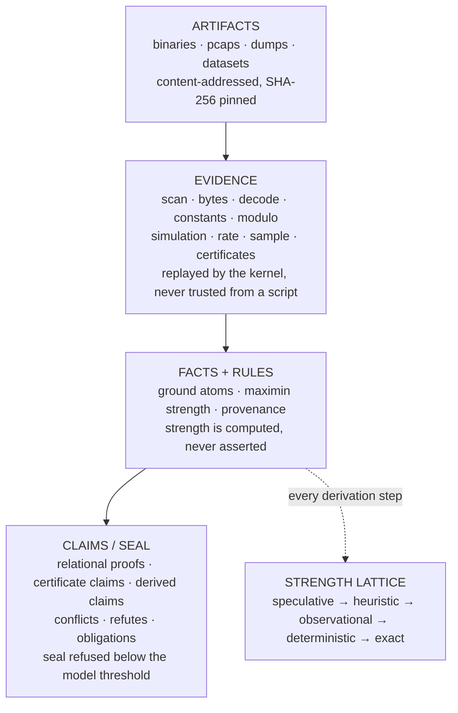
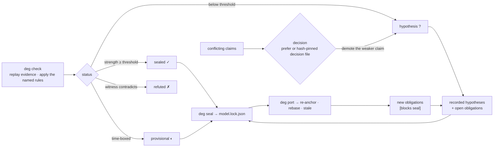
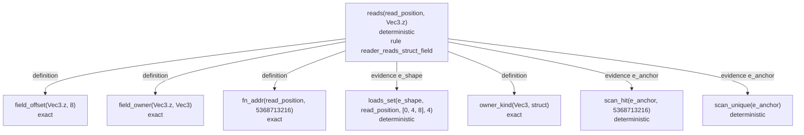

# DeG

[](https://github.com/Sureiya/deg/actions/workflows/ci.yml)

**Evidence-backed proofs for game client/server reverse engineering.**

DeG is a proof language and checker for the claims reverse engineers make every
day: *this offset is `Player.position`*, *opcode `0x1F4` carries authoritative
position*, *the seed is `time()`*, *the server never validates this field*.
Those claims normally live in notes, IDA renames, and forum posts, and silently
rot at every patch. DeG makes them first-class, content-addressed,
machine-checkable, and diffable across builds.

The design is a **Datalog-with-certificates**:

- every claim bottoms out in **hashed artifacts** (binaries, pcaps, dumps, datasets);
- **evidence** is replayed by a small kernel, not trusted from a script;
- **rules** derive facts with an explicit confidence lattice;
- a **seal** is refused when the evidence is weaker than the model's threshold;
- **patch porting** re-anchors what it can and marks the rest stale.

> `deg check` re-runs the evidence. If it passes, the researcher's script does
> not have to be trusted — the bytes, the capture, and the RNG simulation do.

## Quickstart

DeG is a zero-dependency Rust binary.

```console
$ cargo build --release
$ ./target/release/deg check examples/position/model.dg
deg check examples/position/model.dg
  artifacts   5 (5 verified)
  evidence    14 (14 ok)
  claims      7 sealed, 1 provisional, 6 hypothesis, 0 failed/refuted
  obligations 1 open
  conflicts   1 (0 unresolved)
  threshold   deterministic

claims:
  ◐ C_tick          provisional  observational  period(srv_tick, stream:0x01f4) ~ 15625us +- 50us
  ✓ P_algo          sealed       deterministic  algo(srv_rng, MT19937)
  ✓ P_anchor_exact  sealed       exact          anchored(read_position)
  ✓ P_biased        sealed       deterministic  biased(LootTable, 12)
  ✓ P_recovered     sealed       deterministic  recovered(srv_rng, 624, 64)
  ✓ P_reads_vec3_z  sealed       deterministic  reads(read_position, Vec3.z)
  ? P_reads_packet_pos hypothesis observational reads(read_position, S2C_Position.pos)
      note: strength observational is below the seal threshold deterministic
...
kernel: OK
```

Try the rest:

```console
deg explain examples/position/model.dg P_reads_vec3_z   # show the derivation tree
deg seal    examples/position/model.dg                  # write model.lock.json
deg report  examples/position/model.dg                  # Markdown audit report
deg port    examples/port/model.dg --to b2              # re-anchor across a patch
deg stdlib                                             # inspect the rule library
```

`deg check` exits non-zero on hard errors (failed evidence, failed proof,
tampered artifact). Hypotheses, provisional claims, and open obligations are
reported honestly; `deg seal --strict` refuses to write a lock in their presence.

## A taste of the language

```dg
build b1 = binary("game.bin", sha256: "…", arch: x86_64,
                  load: 0x140000000, text: 0x140001000..0x140001400);

struct Vec3 in b1 { x: f32 @ 0; y: f32 @ 4; z: f32 @ 8; } size 12 align 4;

fn read_position in b1 at 0x140001000;

ev e_anchor := scan(b1, ".text", "48 B8 44 65 47 21 62 31 00 00") |> unique;
ev e_shape  := decode(b1, read_position, count: 8);

proof P_reads_z : reads(read_position, Vec3.z) in b1 {
  evidence e_anchor, e_shape;
  rules reader_reads_struct_field;
}

ev e_observe := external("trace.json", kind: trace, build: b1);
proof P_reads_packet : reads(read_position, S2C_Position.pos) in b1 {
  evidence e_observe;
  rules packet_reader_traced;
}
```

The first proof is `Deterministic`: a unique byte anchor plus a kernel-decoded
load set. The second can only be `Observational`, because a dataflow tool
certificate is admitted as external evidence and the kernel cannot re-run the
analysis. The report names that bottleneck rather than averaging it away.

## What the kernel checks

| Primitive | What is re-checked | Strength cap |
|---|---|---|
| `scan` | byte pattern over `.text`; uniqueness proven by a full sweep | Deterministic |
| `bytes` | exact bytes at a virtual address in a hashed image/dump | Deterministic |
| `decode` | a narrow x86-64 load/store + integer subset; partial decode demotes | Deterministic / Heuristic |
| `constants` | requested constants present and unique in a declared window | Deterministic / Heuristic |
| `modulo` | literal `mov reg, imm; …; div reg` in a function | Deterministic |
| `recovery` | **forward-simulates** LCG / xorshift32 / xorshift128 / MT19937 against a hashed dataset | Deterministic |
| `rate` | pcap parse, median inter-arrival, coverage, split-half stationarity | Observational |
| `sample` | pcap field histogram, chi-square, power against the stated alternative | Observational |
| `symbols` | build digest match, symbol/type exactness against the model | Exact |
| `external` | certificate schema + build digest; the analysis is *not* re-run | Observational |
| `absence` | audited scope + time window + build digest | Observational |

The lattice is `Speculative < Heuristic < Observational < Deterministic < Exact`.
Strength is **computed**, never asserted. A rule can cap its conclusion; a
statistical claim can never exceed `Observational`; a derivation made only from
model definitions has no evidence support and cannot seal.

## Architecture

```
┌──────────────────────────────────────────────────────────────┐
│ SEAL / PORT   model.lock.json · port report · obligations    │
├──────────────────────────────────────────────────────────────┤
│ CLAIMS        relational proofs · certificate claims ·       │
│               derived security claims · conflicts · refutes  │
├──────────────────────────────────────────────────────────────┤
│ FACTS + RULES ground atoms · maximin strength · provenance   │
├──────────────────────────────────────────────────────────────┤
│ EVIDENCE      scans · bytes · decode · constants · modulo ·  │
│               simulation · rate · sample · certificates      │
├──────────────────────────────────────────────────────────────┤
│ ARTIFACTS     binaries · pcaps · dumps · datasets (SHA-256)  │
└──────────────────────────────────────────────────────────────┘
```

The same four layers, with the strength lattice that binds them:



And the lifecycle of one claim:



The trusted kernel is `src/{artifact,evidence,facts,kernel,prng,stats,x86,pcap}`.
Rules are visible in `deg stdlib` and are part of the trusted spec; proofs only
apply the rules they name. Model definitions (layouts, function addresses, RNG
sites) are *assumptions*, audited in the report, not secret axioms.

## See it work

Everything below is the verbatim output of the binary in this repository
(`cargo build --release && ./target/release/deg …`), not edited by hand.
Elisions are marked with `…` or `...` and nothing else is touched.

### Check a model

```console
$ deg check examples/position/model.dg
deg check examples/position/model.dg
  artifacts   5 (5 verified)
  evidence    14 (14 ok)
  claims      7 sealed, 1 provisional, 6 hypothesis, 0 failed/refuted
  obligations 1 open
  conflicts   1 (0 unresolved)
  decisions   0 (0 ok)
  threshold   deterministic

claims:
  ? C_loot_uniform               hypothesis   observational  uniform(LootTable, bins:12)
      note: demoted by conflict C_loot: modulo bias is provable from code; a 12k-sample histogram is underpowered…
  ? C_predictable                hypothesis   observational  predictable(srv_rng, conn_7, 32)
      note: at least one premise is only a hypothesis
      bottleneck: P_observable
  ? C_tamperable                 hypothesis   observational  tamperable(Player.position)
      note: at least one premise is only a hypothesis
      bottleneck: P_reads_packet_pos
  ◐ C_tick                       provisional  observational  period(srv_tick, stream:0x01f4) ~ 15625us +- 50us
      note: provisional until 2099-12-31
  ? P_absence                    hypothesis   observational  absent_field(S2C_Position.pos, ".text", 5368713216, 5368714240)
      note: strength observational is below the seal threshold deterministic
  ✓ P_algo                       sealed       deterministic  algo(srv_rng, MT19937)
  ✓ P_anchor_exact               sealed       exact          anchored(read_position)
  ✓ P_biased                     sealed       deterministic  biased(LootTable, 12)
  ✓ P_layout_exact               sealed       exact          layout_exact(Vec3)
...
```

The `…` on the C_loot note marks where that long note was trimmed; the `...`
line marks where the rest of the claims list was cut.

### Explain a claim — the derivation as a Mermaid flowchart

````console
$ deg explain examples/position/model.dg P_reads_vec3_z --mermaid

````

The rule that derives the goal is on the goal node; every edge is labeled with
what its premise is — a model definition, or evidence the kernel replayed.

### Seal — a reproducible lock

```console
$ deg seal examples/position/model.dg --out /tmp/show.lock.json
sealed 7 claim(s) (1 provisional) into /tmp/show.lock.json
recorded 6 hypothesis/hypotheses: C_loot_uniform, C_predictable, C_tamperable, P_absence, P_observable, P_reads_packet_pos
open obligations recorded: O_recheck_rate
```

The lock is deterministic JSON with sorted keys. Excerpt — one artifact entry
and the sealed/recorded names, everything in between elided:

```json
{
  "artifact_count": 5,
  "artifacts": [
    {
      "kind": "binary",
      "name": "b1",
      "path": "examples/fixtures/game-b1.bin",
      "sha256": "470de64c4b572ec064a0e14e1831017dea5c6204f24383f0bc31b9cd474beca6",
      "verified": true
    },
    … 4 more artifact entries …
  ],
  … conflicts / decisions / definitions elided …
  "deg_version": "0.1.0",
  "hypotheses": [ "C_loot_uniform", "C_predictable", "C_tamperable", "P_absence", "P_observable", "P_reads_packet_pos" ],
  "model": "examples/position/model.dg",
  "obligations": [ "O_layout", "O_recheck_rate" ],
  "seal_threshold": "deterministic",
  "sealed": [ "C_tick", "P_algo", "P_anchor_exact", "P_biased", "P_layout_exact", "P_reads_vec3_z", "P_recovered", "R_not_xorshift" ]
}
```

### Port across a patch — an honest report, not a silent keep

```console
$ deg port examples/port/model.dg --to b2 --markdown
# DeG port report — `examples/port/model.dg` → `b2`

## Mappings

| Kind | Name | Old | New | Similarity | How |
|---|---|---|---|---|---|
| fn | `read_position` | `0x140001000` | `0x140001080` | 0.98 | structural_similarity |
| rng | `srv_rng` | `0x140001200` | `0x140001280` | 0.96 | structural_similarity |

## Claims

| Claim | Source build | Action | Status | Strength | Notes |
|---|---|---|---|---|---|
| `P_algo` | `b1` | stale | stale | deterministic | stale: `e_mt_consts`: constant 0xefc60000 missing in the target window |
| `P_reads` | `b1` | rebased | demoted | deterministic → heuristic | ported strength heuristic is below the seal threshold deterministic; re-discharge obligations |
| `P_recovered` | `b1` | failed | failed | deterministic | could not re-derive recovered(srv_rng, 624, 64) against b2; re-anchor or re-validate |

… the new-obligation and warning sections follow …
```

The reader proof is re-anchored by structural similarity, so it is *demoted*
from `deterministic` to `heuristic` — the port never silently keeps a claim.

### The rest of the surface

```console
deg report examples/position/model.dg   # full Markdown audit — see docs/tutorial.md §10
deg stdlib                              # the rule library the proofs draw from
deg extensions                          # compiled-in evidence kinds (none in the core binary)
```

## Why DeG

Claims about a game binary rot at every patch: the offsets move, the opcodes
change, the seed source disappears. DeG binds each claim to hashed artifacts
and computes its strength from evidence the kernel replays, never from
asserted confidence. A seal is a reproducible lock — re-run the check and you
get the same strengths, or a loud failure. A port report says exactly which
claim broke, why, and what must be re-earned before the new build can seal.

## Repository layout

```
src/            the kernel, parser, CLI (zero dependencies)
docs/           design, formal semantics, grammar, tutorial
examples/       checked, content-addressed examples
tools/          deterministic fixture generator
tests/          end-to-end CLI tests
```

## Status

**v0.1 — a working kernel and a deliberate prototype.**

Implemented end-to-end:

- artifact hashing and virtual-address mapping;
- byte scans, exact bytes, narrow x86-64 decode, constants, literal-modulo witnesses;
- MT19937 / xorshift32 / xorshift128 / LCG forward simulation and recovery witnesses;
- pcap parsing, rate/period claims, uniform-distribution claims with chi-square and power checks;
- a negation-free Datalog engine with maximin strength and provenance;
- relational proofs, composed claims, conflicts with explicit preference, refutations, obligations;
- sealing to a deterministic JSON lock, Markdown reports, derivations, JSON output;
- patch porting with unique-pattern re-anchoring and LCS structural rebasing.

Designed but not implemented (see [design](docs/design.md) and
[open problems](docs/design.md#16-open-problems)):

- a full disassembler / dataflow engine (external certificates stand in, capped at Observational);
- cross-clock conversion and `relate` enforcement (clocks are parsed and checked for identity only);
- seed-keyspace entropy claims, fork detection, white-box RNG handling;
- porting of statistical claims (they go stale and generate a revalidation obligation);
- SMT-backed offset arithmetic and a general temporal fragment.

## Scope and ethics

DeG is a tool for **fair-use** reverse engineering, interoperability, and
preservation research. It is not a cheat, a memory editor, or a packet
injector. It only *checks claims about artifacts you already have*; it does
not attack a live service or bypass access controls.

## Documentation

- [Design](docs/design.md) — the full language and its trust model.
- [Semantics](docs/semantics.md) — judgments, strength algebra, seal and port rules.
- [Grammar](docs/grammar.ebnf) — the surface language.
- [Tutorial](docs/tutorial.md) — read, run, and extend a model.
- [Examples](examples/README.md) — timing, RNG, conflict, and porting.
- [Provenance](docs/source.md) — the design conversation that seeded the project.

## License

MIT. See [LICENSE](LICENSE).
